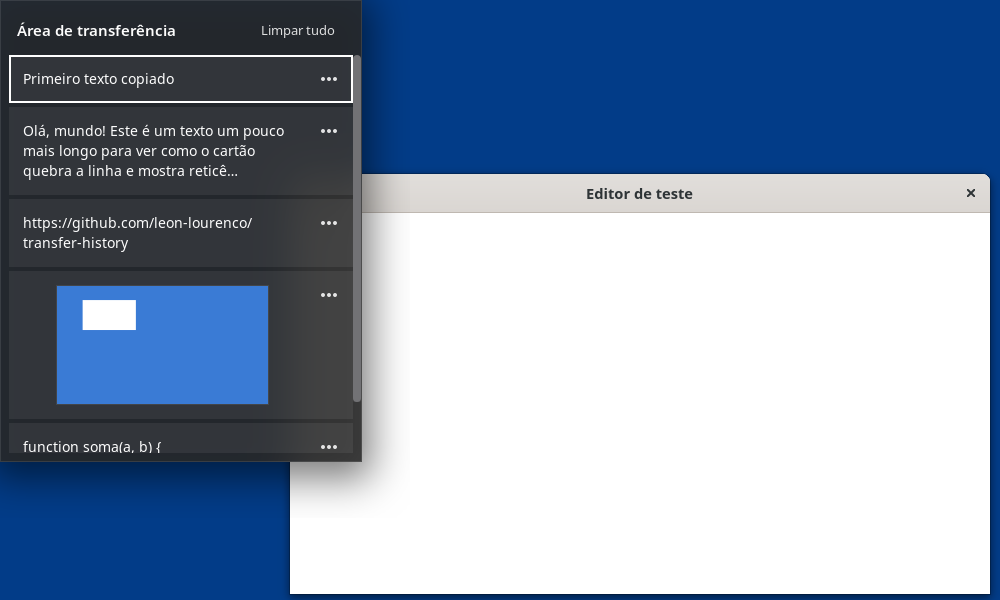
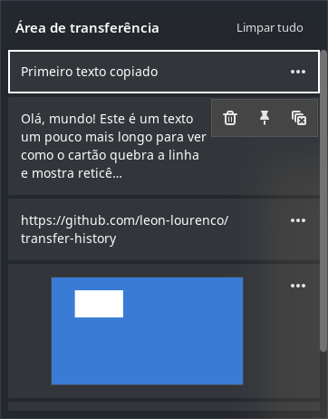
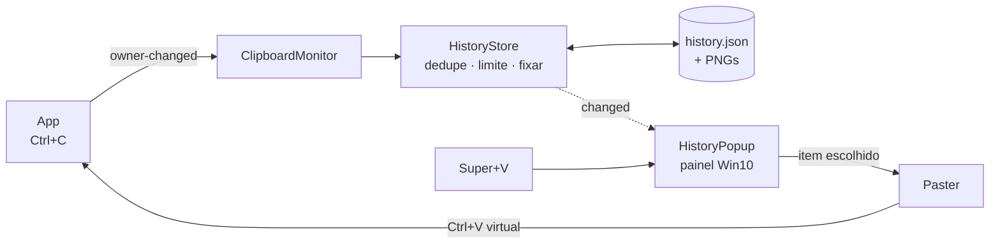

<div align="center">

# 📋 Transfer History

**O histórico da área de transferência do Windows 10 (<kbd>Win</kbd>+<kbd>V</kbd>), no GNOME.**<br>
Copie à vontade; aperte <kbd>Super</kbd>+<kbd>V</kbd>, escolha, e ele cola.




</div>

---

## Por quê

No Wayland, um app comum **não consegue** ler a área de transferência em segundo plano, registrar
um atalho global nem colar em outra janela. Os gerenciadores de clipboard que funcionam no GNOME
são extensões — mas nenhum tem a cara e o jeito do <kbd>Win</kbd>+<kbd>V</kbd>, que é rápido,
silencioso e cola direto onde você estava.

O Transfer History é uma extensão do GNOME Shell que reproduz esse painel: mesmo layout, mesmas
ações, mesmo atalho.

## Recursos

<table>
<tr>
<td width="50%">

- ⌨️ **<kbd>Super</kbd>+<kbd>V</kbd>** abre o painel junto ao ponteiro
- 📥 **Cola na hora** na janela onde você estava (terminais incluídos)
- 🖼️ **Texto e imagens**, com miniatura
- 📌 **Fixar** itens que sobrevivem a “Limpar tudo”
- 💾 **Persistente**: o histórico continua depois de reiniciar
- 🔁 **Sem duplicatas**: copiar de novo só traz o item para o topo
- ⌨️ Navegação completa pelo teclado: <kbd>↑</kbd> <kbd>↓</kbd> <kbd>Enter</kbd> <kbd>Delete</kbd> <kbd>Esc</kbd>
- 🔒 **Privado**: nada sai da máquina; senhas de gerenciadores não são guardadas

</td>
<td width="50%" align="center">



</td>
</tr>
</table>

## Requisitos

| | |
|---|---|
| Ambiente | GNOME Shell **50** (testado no Ubuntu 26.04) |
| Sessão | Wayland ou X11 |
| Dependências | nenhuma além do próprio GNOME |

## Instalação

```bash
git clone https://github.com/leon-lourenco/transfer-history.git
cd transfer-history
./install.sh
```

Saia e entre na sessão (no Wayland o Shell só carrega extensões novas no login), e ligue:

```bash
gnome-extensions enable clipboard-history-win10@leon
```

<details>
<summary>Instalação manual, sem o script</summary>

```bash
glib-compile-schemas extension/schemas
ln -s "$PWD/extension" ~/.local/share/gnome-shell/extensions/clipboard-history-win10@leon
# saia e entre na sessão
gnome-extensions enable clipboard-history-win10@leon
```

</details>

## Uso

| Atalho | Ação |
|---|---|
| <kbd>Super</kbd>+<kbd>V</kbd> | abre / fecha o histórico |
| <kbd>↑</kbd> <kbd>↓</kbd> | navega entre os itens |
| <kbd>Enter</kbd> ou clique | cola o item na janela anterior |
| <kbd>Delete</kbd> | exclui o item em foco |
| <kbd>Esc</kbd> ou clique fora | fecha (ou fecha o menu ⋯) |
| **⋯** no item | Excluir · Fixar/Desafixar · Limpar tudo |

> A bandeja de notificações, que também usava <kbd>Super</kbd>+<kbd>V</kbd>, continua em
> <kbd>Super</kbd>+<kbd>M</kbd>. Ao desligar a extensão, o atalho original volta.

## Configuração

```bash
SCHEMA=org.gnome.shell.extensions.clipboard-history-win10
DIR=~/.local/share/gnome-shell/extensions/clipboard-history-win10@leon/schemas

gsettings --schemadir $DIR set $SCHEMA max-items 50            # padrão: 25, como no Windows
gsettings --schemadir $DIR set $SCHEMA paste-on-select false   # só copia, não cola sozinho
gsettings --schemadir $DIR set $SCHEMA toggle-history "['<Super><Shift>v']"
```

Todas as chaves: [docs/dados.md](docs/dados.md#preferências-gsettings).

## Privacidade

- O histórico fica em `~/.local/share/clipboard-history-win10/`, legível só pelo seu usuário.
- Nenhum dado vai para a rede. Não há sincronização.
- Conteúdo marcado por gerenciadores de senha (KeePassXC e afins) é ignorado.
- Para apagar tudo: desligue a extensão e `rm -rf ~/.local/share/clipboard-history-win10`.

## Como funciona



Uma extensão do GNOME Shell, em JavaScript (GJS), com cinco módulos pequenos. A arquitetura
completa — C4, sequências, estados, dados e decisões — está em **[docs/](docs/README.md)**.

## Desenvolvimento

```text
extension/
├── extension.js         ponto de entrada; atalho e troca do Super+V
├── clipboardMonitor.js  ouve a área de transferência
├── historyStore.js      lista, dedupe, limite, fixar, disco
├── popup.js             o painel
├── paster.js            devolve o item e envia Ctrl+V
├── stylesheet.css       o visual do Windows 10
└── schemas/             preferências (GSettings)
tests/e2e/               Shell headless + cenário automatizado
docs/                    arquitetura, fluxos, dados, visual, operação, ADRs
```

```bash
tests/e2e/run.sh                          # teste de ponta a ponta, isolado da sua sessão
journalctl -f -o cat /usr/bin/gnome-shell # logs da extensão
./install.sh --zip                        # pacote para extensions.gnome.org
```

O teste E2E sobe um GNOME Shell headless com dconf e dados próprios, copia textos e uma imagem,
aperta <kbd>Super</kbd>+<kbd>V</kbd> → <kbd>↓</kbd> → <kbd>Enter</kbd> e confere que o texto chegou a um
editor GTK de verdade. Detalhes em [docs/operacao.md](docs/operacao.md#teste-de-ponta-a-ponta).

## Roadmap

- [ ] Tema claro, seguindo o sistema
- [ ] Abrir junto ao cursor de texto (via acessibilidade), como no Windows
- [ ] Busca no histórico
- [ ] Abas de emoji, kaomoji e símbolos (Windows 10 21H1+)
- [ ] Janela de preferências (`prefs.js`)
- [ ] Publicar no extensions.gnome.org

## Contribuir

1. Leia [AGENTS.md](AGENTS.md) — vale para pessoas também.
2. Mudou comportamento? Atualize o diagrama em `docs/` no mesmo commit.
3. Decisão nova? Escreva um ADR em `docs/decisoes/`.
4. Rode `tests/e2e/run.sh` antes de abrir o PR.

## Licença

[MIT](LICENSE) © 2026 Leonardo Lourenço.
Windows é marca registrada da Microsoft; este projeto não tem relação com ela.
