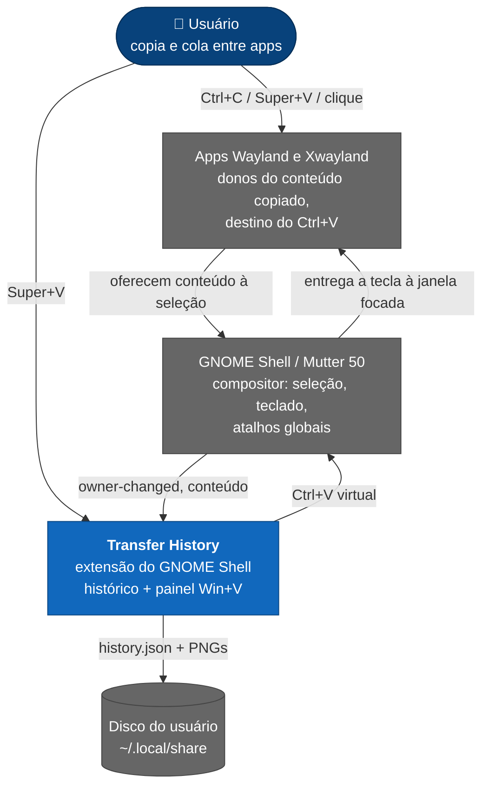
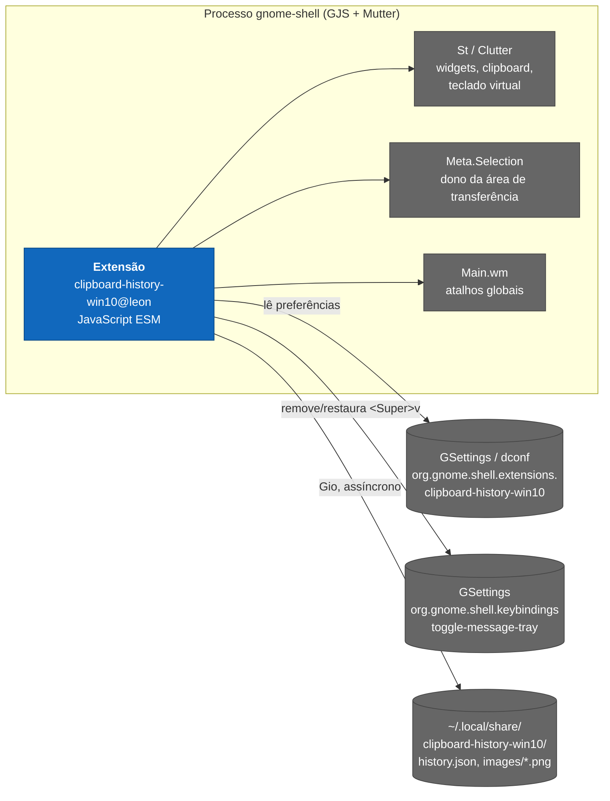
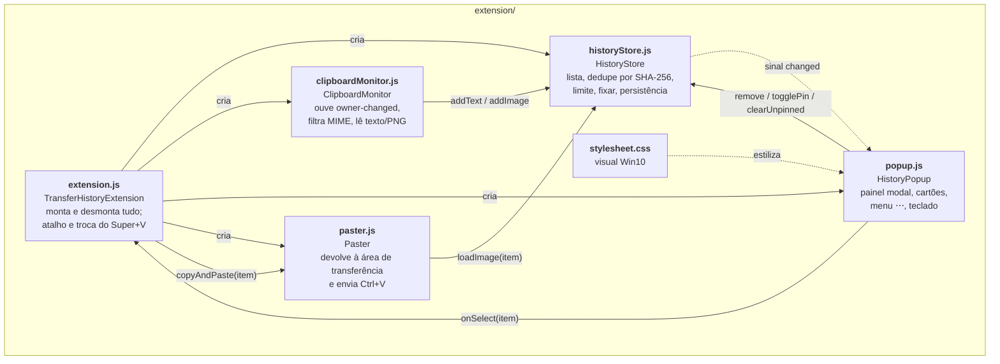
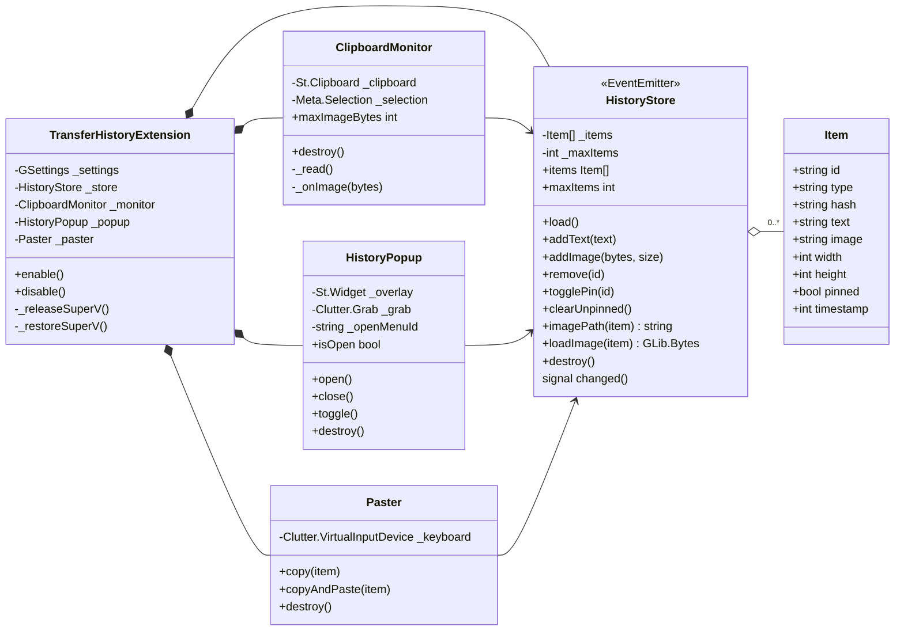
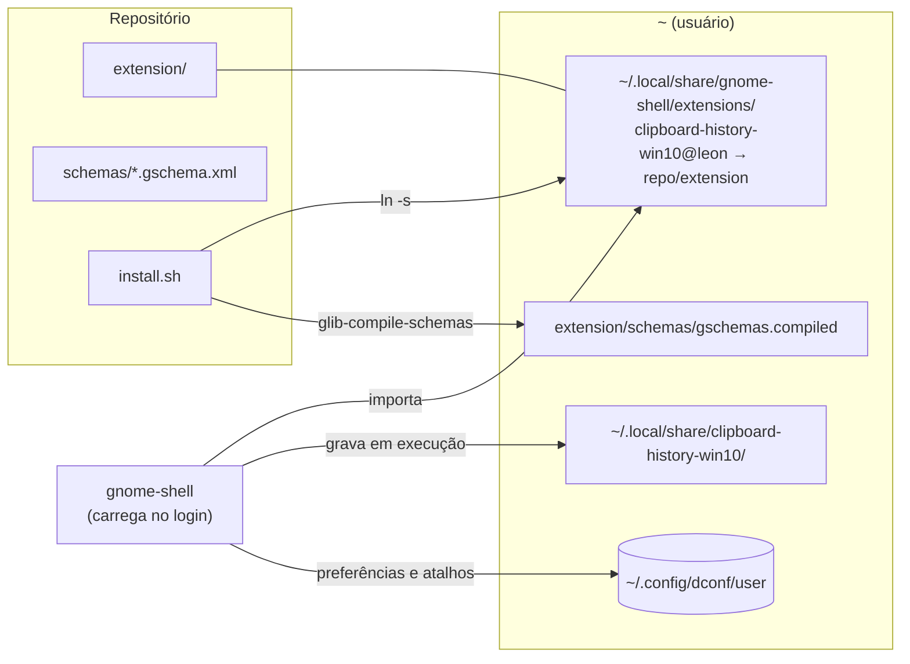

# Arquitetura

Como o Transfer History é montado, do contexto até as classes. Os fluxos no tempo estão em
[fluxos.md](fluxos.md); o formato em disco, em [dados.md](dados.md).

## Requisitos

### Funcionais

| # | Requisito | Onde |
|---|---|---|
| RF1 | Guardar cada texto e imagem copiados em qualquer app | `ClipboardMonitor` → `HistoryStore` |
| RF2 | Abrir o painel com <kbd>Super</kbd>+<kbd>V</kbd>, perto do ponteiro | `extension.js`, `HistoryPopup` |
| RF3 | Clicar ou dar <kbd>Enter</kbd> num item cola na janela focada | `Paster` |
| RF4 | Menu “⋯” por item: Excluir, Fixar/Desafixar, Limpar tudo | `HistoryPopup` |
| RF5 | “Limpar tudo” apaga só os não fixados | `HistoryStore.clearUnpinned` |
| RF6 | Histórico sobrevive a logout e reinício | `HistoryStore` ([ADR-0004](decisoes/0004-persistencia-json-mais-pngs.md)) |
| RF7 | Até 25 itens não fixados; fixados não contam | `HistoryStore._trim` ([ADR-0005](decisoes/0005-limite-de-25-itens-e-fixados-fora-do-limite.md)) |
| RF8 | Visual do Win+V do Windows 10, tema escuro | `stylesheet.css` ([visual.md](visual.md)) |

### Não funcionais (atributos de qualidade)

| Atributo | Meta | Como |
|---|---|---|
| **Privacidade** | Nada sai da máquina; conteúdo de gerenciador de senha não é guardado | Sem rede; arquivos `0600`/`0700`; filtro de MIME sensível |
| **Robustez** | Desligar a extensão deixa o Shell exatamente como estava | `disable()` desfaz sinais, atalhos, timers, atores e o atalho da bandeja |
| **Desempenho** | O Shell nunca trava por causa do histórico | Escrita assíncrona com *debounce* de 500 ms; leitura síncrona só no `enable()` |
| **Compatibilidade** | GNOME Shell 50, Wayland | APIs conferidas no JS do próprio Shell ([AGENTS.md](../AGENTS.md)) |
| **Testabilidade** | Fluxo inteiro testável sem mexer na sessão do usuário | Shell headless isolado em `tests/e2e/` ([operacao.md](operacao.md#teste-de-ponta-a-ponta)) |

## C4 — nível 1: contexto

No Wayland, só o compositor vê a área de transferência de todos os apps e só ele injeta teclas
em outra janela. Por isso o sistema vive **dentro** do GNOME Shell
([ADR-0001](decisoes/0001-extensao-gnome-shell-em-vez-de-app.md)).

## C4 — nível 2: contêineres

## C4 — nível 3: componentes

Dependências apontam para o `HistoryStore`, que não conhece nenhum outro módulo: é o único estado
e o único dono do disco. O painel só **lê** a lista e pede mudanças; redesenha quando ouve `changed`.

## Classes

## Implantação

A instalação por *symlink* faz cada edição no repositório valer no próximo login. Para publicar no
extensions.gnome.org, `./install.sh --zip` gera o pacote.

## Decisões

As decisões que moldam esta arquitetura estão em [decisoes/](decisoes/). Resumo:

| ADR | Decisão |
|---|---|
| [0001](decisoes/0001-extensao-gnome-shell-em-vez-de-app.md) | Extensão do GNOME Shell, não app separado |
| [0002](decisoes/0002-super-v-remapeia-bandeja-de-notificacoes.md) | Super+V é tirado da bandeja de notificações e devolvido no `disable()` |
| [0003](decisoes/0003-colar-via-teclado-virtual-do-clutter.md) | Colar com Ctrl+V de um teclado virtual do Clutter |
| [0004](decisoes/0004-persistencia-json-mais-pngs.md) | Persistência em JSON + PNGs por hash |
| [0005](decisoes/0005-limite-de-25-itens-e-fixados-fora-do-limite.md) | Limite de 25 itens; fixados fora do limite |
