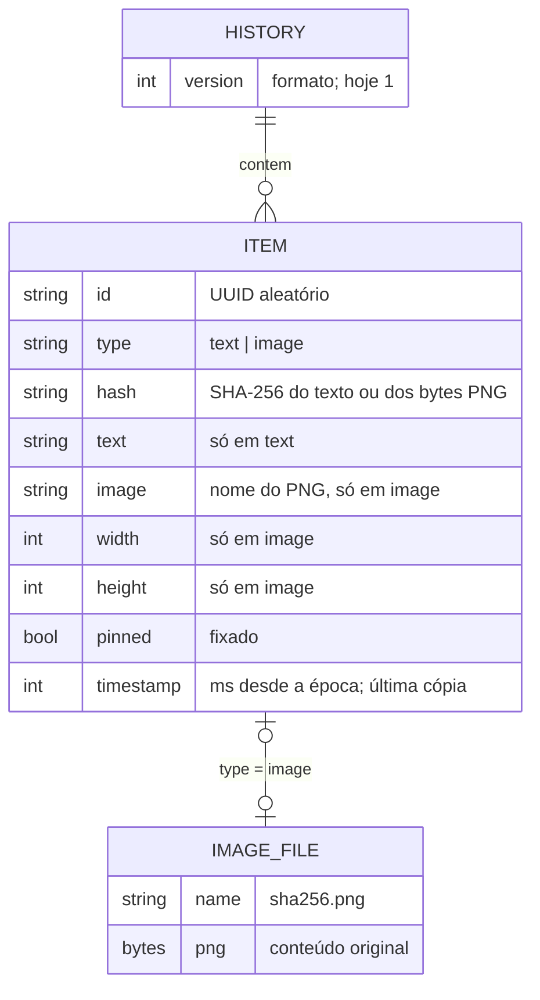

# Dados

O que o Transfer History guarda, onde e em que formato. Decisão:
[ADR-0004](decisoes/0004-persistencia-json-mais-pngs.md).

## Onde fica

```
~/.local/share/clipboard-history-win10/      (0700)
├── history.json                              (0600) lista de itens, mais recente primeiro
└── images/
    └── <sha256>.png                          (0600) uma por imagem distinta
```

`~/.local/share` é `$XDG_DATA_HOME` quando definido. Os arquivos são criados com
`G_FILE_CREATE_PRIVATE`: só o seu usuário lê.

## Modelo



## Exemplo de `history.json`

```json
{
  "version": 1,
  "items": [
    {
      "id": "6b0c2c3e-6f0d-4d7e-9d0e-1f1d6a2b9c11",
      "type": "text",
      "hash": "a3f1…",
      "text": "Primeiro texto copiado",
      "pinned": false,
      "timestamp": 1793112345678
    },
    {
      "id": "0d6e5b1a-2f8c-4a43-8e3c-7a9f0e4b2d55",
      "type": "image",
      "hash": "9c2e…",
      "image": "9c2e….png",
      "width": 640,
      "height": 360,
      "pinned": true,
      "timestamp": 1793112300000
    }
  ]
}
```

## Regras

| Regra | Detalhe |
|---|---|
| Ordem | A lista é a ordem de exibição: o mais recente em cima. Fixar não muda a posição |
| Dedupe | Mesmo `hash` não entra duas vezes; a cópia repetida move o item para o topo e atualiza `timestamp` |
| Limite | `max-items` (25) itens **não fixados**; ao passar, saem os não fixados mais antigos ([ADR-0005](decisoes/0005-limite-de-25-itens-e-fixados-fora-do-limite.md)) |
| Texto | Vazio ou só espaços é ignorado; acima de 1 MiB é truncado |
| Imagem | Só `image/png`; acima de `max-image-bytes` (8 MiB) é ignorada. O PNG é apagado quando nenhum item o referencia |
| Sensível | Conteúdo marcado com `x-kde-passwordManagerHint` (KeePassXC, entre outros) não é lido |
| Leitura | Arquivo ausente ou corrompido: começa vazio e registra um aviso no log do Shell. Itens de imagem cujo PNG sumiu são descartados |
| Escrita | Assíncrona, 500 ms depois da última mudança; no `disable()`, síncrona, para não perder nada |

## Preferências (GSettings)

Schema `org.gnome.shell.extensions.clipboard-history-win10`:

| Chave | Tipo | Padrão | Para quê |
|---|---|---|---|
| `toggle-history` | `as` | `['<Super>v']` | atalho que abre o painel |
| `max-items` | `i` (5–200) | `25` | limite de itens não fixados |
| `max-image-bytes` | `i` | `8388608` | tamanho máximo de imagem guardada |
| `paste-on-select` | `b` | `true` | colar ao escolher; `false` só copia |
| `saved-message-tray-binding` | `as` | `[]` | uso interno: atalho original da bandeja ([ADR-0002](decisoes/0002-super-v-remapeia-bandeja-de-notificacoes.md)) |

## Apagar tudo

```bash
rm -rf ~/.local/share/clipboard-history-win10
```

Com a extensão ligada, faça isso depois de desligá-la; senão o `disable()` grava a lista de novo.
