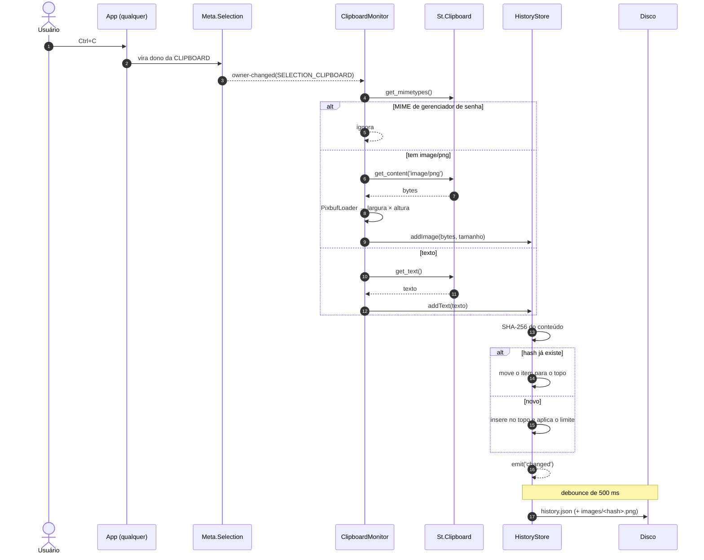
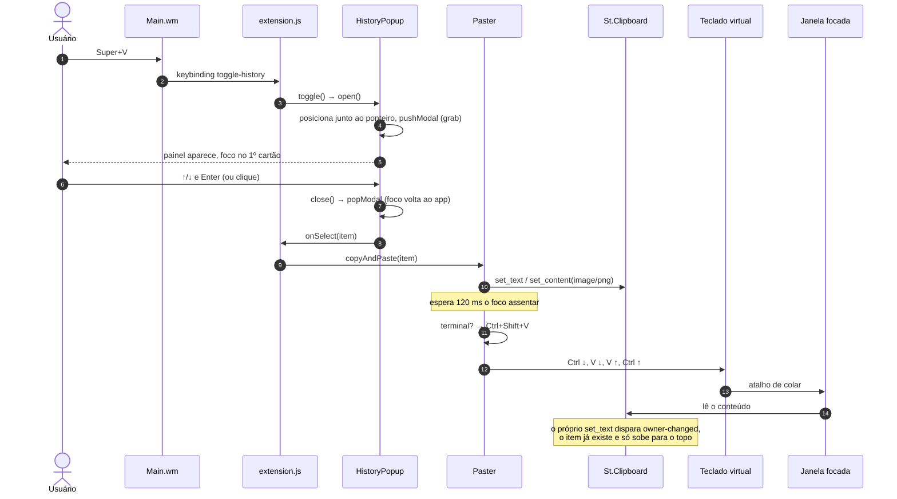
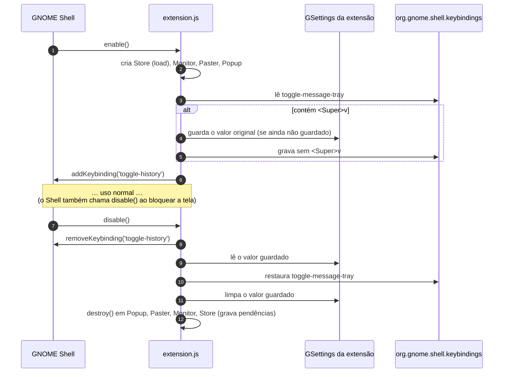
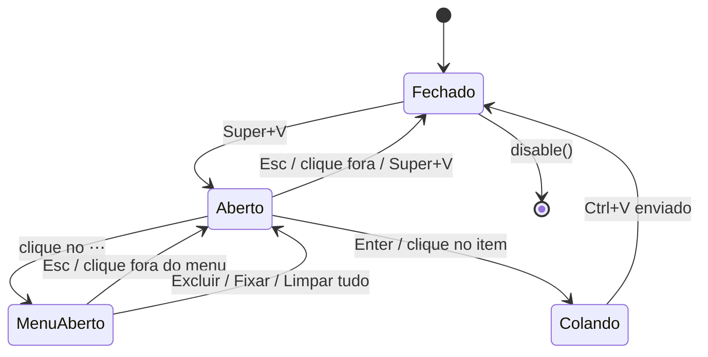
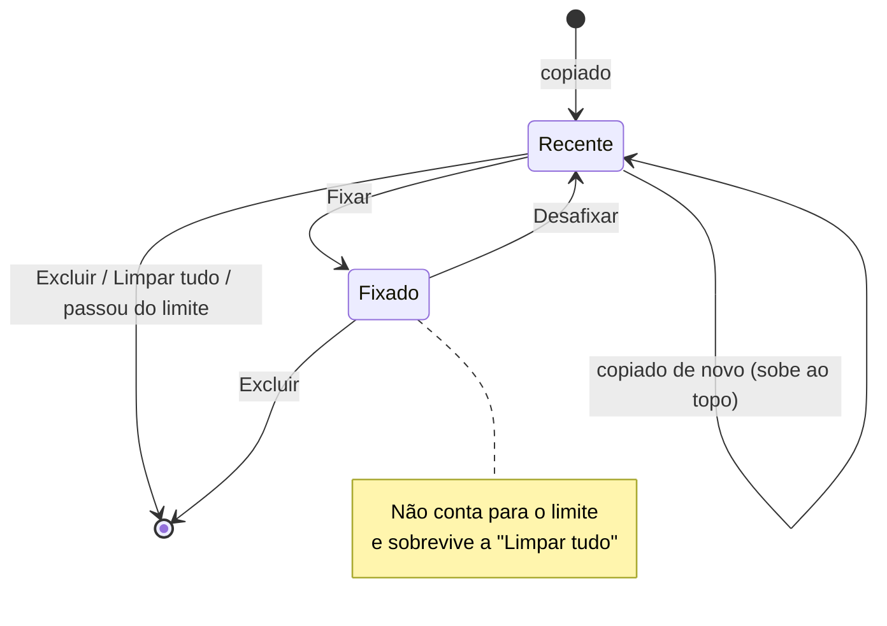

# Fluxos

O comportamento no tempo: o que acontece ao copiar, ao colar pelo painel e ao ligar/desligar a
extensão. A estrutura estática está em [arquitetura.md](arquitetura.md).

## 1. Copiar → guardar

## 2. Super+V → colar

Com a preferência `paste-on-select = false`, o passo do teclado virtual não acontece: o item só
volta para a área de transferência.

## 3. Ligar e desligar a extensão

Se o Shell cair sem chamar `disable()`, o valor original continua guardado e o próximo `enable()`
não o sobrescreve ([ADR-0002](decisoes/0002-super-v-remapeia-bandeja-de-notificacoes.md)).

## Estados do painel

## Ciclo de vida de um item

