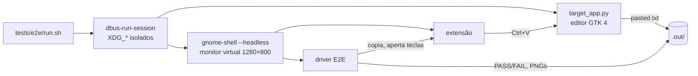

# Operação

Instalar, configurar, depurar, testar e remover.

## Instalar

```bash
git clone https://github.com/leon-lourenco/transfer-history.git
cd transfer-history
./install.sh
```

O script compila o schema e cria um *symlink* em
`~/.local/share/gnome-shell/extensions/clipboard-history-win10@leon`. No Wayland o Shell não
recarrega extensões novas: **saia e entre na sessão**, depois:

```bash
gnome-extensions enable clipboard-history-win10@leon
```

Ao ligar, o <kbd>Super</kbd>+<kbd>V</kbd> sai da bandeja de notificações (que continua em
<kbd>Super</kbd>+<kbd>M</kbd>) e passa a abrir o histórico.

## Configurar

```bash
SCHEMA=org.gnome.shell.extensions.clipboard-history-win10
DIR=~/.local/share/gnome-shell/extensions/clipboard-history-win10@leon/schemas

# outro atalho
gsettings --schemadir $DIR set $SCHEMA toggle-history "['<Super><Shift>v']"
# guardar 50 itens
gsettings --schemadir $DIR set $SCHEMA max-items 50
# só copiar, sem colar sozinho
gsettings --schemadir $DIR set $SCHEMA paste-on-select false
```

Todas as chaves estão em [dados.md](dados.md#preferências-gsettings). As mudanças valem na hora,
menos o atalho, que vale ao religar a extensão.

## Depurar

```bash
# erros e avisos da extensão (prefixo [transfer-history])
journalctl -f -o cat /usr/bin/gnome-shell

# estado
gnome-extensions info clipboard-history-win10@leon
```

Para mexer no código sem sair da sessão, use uma sessão aninhada (precisa do pacote
`mutter-dev-bin`/`mutter-devkit`):

```bash
dbus-run-session gnome-shell --devkit --wayland
```

## Teste de ponta a ponta

```bash
tests/e2e/run.sh
```

Sobe um GNOME Shell **headless** dentro de um `dbus-run-session`, com `XDG_CONFIG_HOME`,
`XDG_DATA_HOME` e `XDG_RUNTIME_DIR` próprios: não lê nem altera seu dconf, seu histórico ou sua
sessão. Lá dentro carrega a extensão e uma extensão de teste (`tests/e2e/driver/`) que:

1. copia textos, um bloco de código e uma imagem; repete uma cópia;
2. abre o painel, o menu ⋯, fixa a imagem e tira screenshots;
3. aperta <kbd>Super</kbd>+<kbd>V</kbd>, <kbd>↓</kbd>, <kbd>Enter</kbd> com um teclado virtual e confere
   que o texto apareceu num editor GTK de verdade (`tests/e2e/target_app.py`);
4. confere o `history.json`, o “Limpar tudo” com fixados, o estado vazio;
5. desliga e religa a extensão e confere que o atalho da bandeja volta.

Saída em `tests/e2e/.out/`: `log.txt` com uma linha `PASS`/`FAIL` por verificação, os screenshots
e o log do Shell. O script sai com código 1 se algo falhar.



## Atualizar

Com a instalação por *symlink*, basta `git pull` e sair/entrar na sessão. O formato do
`history.json` tem `version`; uma mudança de formato precisa de migração no `HistoryStore.load()`.

## Remover

```bash
./install.sh --remove                       # desliga e tira o symlink; Super+V volta para a bandeja
rm -rf ~/.local/share/clipboard-history-win10   # apaga o histórico (opcional)
```

## Problemas comuns

| Sintoma | Causa provável | O que fazer |
|---|---|---|
| Super+V ainda abre as notificações | extensão não ligou | `gnome-extensions info …` e o `journalctl` acima |
| Não cola num app específico | o app usa outro atalho de colar | escolha o item e cole à mão; abra uma *issue* com o `wm_class` (veja no Looking Glass, <kbd>Alt</kbd>+<kbd>F2</kbd> `lg`) |
| Terminal cola com `^V` | terminal fora da lista de `paster.js` | adicione o `wm_class` em `TERMINAL_WM_CLASSES` |
| Imagem não aparece no histórico | app oferece só outro formato (JPEG, BMP) ou passou de 8 MiB | só `image/png` é lido |
| Super+V sumiu de vez da bandeja | Shell caiu sem `disable()` e a extensão foi removida | `gsettings reset org.gnome.shell.keybindings toggle-message-tray` |
