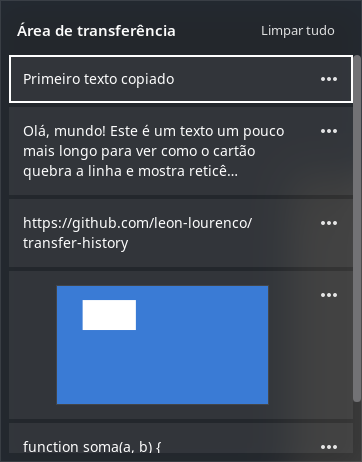
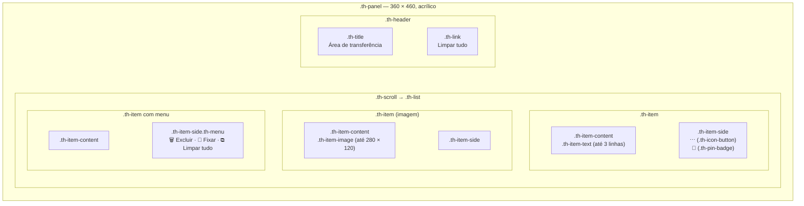
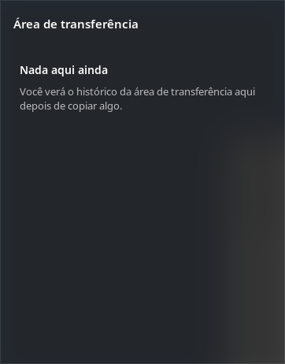

# Especificação visual

O alvo é o painel do <kbd>Win</kbd>+<kbd>V</kbd> do Windows 10 (versão 1809 em diante), tema escuro.
Esta página é a referência do `extension/stylesheet.css`: mudou um valor lá, mude aqui.

  
  

## Anatomia

## Medidas

| Elemento | Valor | Observação |
|---|---|---|
| Painel | 360 × 460 px, cantos retos | O Windows 10 não arredonda (o 11 sim) |
| Cabeçalho | padding 14 / 16 / 10 / 16 | título à esquerda, “Limpar tudo” à direita |
| Lista | padding lateral 8, espaço entre cartões 4 | rola na vertical; barra sobreposta |
| Cartão | borda 2 px (transparente; branca no foco) | altura pelo conteúdo, **sem `min-height`** (ver abaixo) |
| Conteúdo do cartão | padding 12 / 4 / 12 / 12 | |
| Prévia de texto | 14 px, até 3 linhas visuais, “…” no corte | corte estimado em 34 caracteres por linha |
| Miniatura | até 280 × 120 px, proporção mantida | `background-size: contain` |
| Botão de ícone | 32 × 32, ícone 16 px | ⋯, Excluir, Fixar, Limpar tudo |
| Distância do ponteiro | 8 px | abre abaixo; se não couber, acima |
| Animação de abertura | 150 ms, opacidade 0→1 e 8 px de subida | `EASE_OUT_QUAD` |

## Cores

| Token | Valor | Uso |
|---|---|---|
| Fundo do painel | `rgba(43, 43, 43, 0.82)` + desfoque do fundo (raio 40, brilho 0,75) | efeito acrílico |
| Borda do painel | `rgba(255, 255, 255, 0.10)` | |
| Sombra | `0 8px 32px rgba(0, 0, 0, 0.55)` | |
| Cartão | `rgba(255, 255, 255, 0.07)` | |
| Cartão em *hover* | `rgba(255, 255, 255, 0.13)` | |
| Foco | borda `#ffffff` 2 px | o “retângulo de foco” do Windows |
| Menu ⋯ | `rgba(70, 70, 70, 0.96)` + borda `rgba(255,255,255,0.10)` | flyout um tom acima |
| Texto principal | `#ffffff` | |
| Texto secundário | `rgba(255, 255, 255, 0.70)` | estado vazio, alfinete |
| Ícones | `rgba(255, 255, 255, 0.86)`; `#ffffff` em *hover* | |

## Tipografia

`"Segoe UI", "Selawik", "Cantarell", sans-serif`. Segoe UI só existe se você instalou; Selawik é a
alternativa aberta da Microsoft com as mesmas métricas. Título 15 px seminegrito; itens 14 px;
“Limpar tudo” 13 px.

## Textos

| Lugar | Texto |
|---|---|
| Título | Área de transferência |
| Ação do cabeçalho | Limpar tudo |
| Menu ⋯ | Excluir · Fixar / Desafixar · Limpar tudo (nomes acessíveis dos ícones) |
| Vazio | **Nada aqui ainda** — Você verá o histórico da área de transferência aqui depois de copiar algo. |

## Estados

  
  

- **Foco pelo teclado:** borda branca de 2 px no cartão inteiro (`.th-item:focus`, aplicada pelo
  código quando o botão de conteúdo recebe foco).
- **Fixado:** alfinete abaixo do ⋯.
- **Sem itens não fixados:** “Limpar tudo” fica invisível mas ocupa o lugar, para o cabeçalho não pular.

## Armadilhas do St (o CSS do GNOME Shell)

- **`min-height` substitui a altura mínima calculada.** O viewport do `St.ScrollView` aloca os filhos
  pela altura mínima; com `min-height` no cartão, a lista era espremida em vez de rolar.
- **`ellipsize` faz a altura mínima de um rótulo virar uma linha**, pelo mesmo motivo. O corte em
  3 linhas é feito no JavaScript (`previewText`), e o rótulo só quebra linha.
- O teste E2E verifica as duas coisas (“cartões no tamanho natural”).

## Diferenças conhecidas do original

| Windows 10 | Aqui | Por quê |
|---|---|---|
| Abre junto ao cursor de texto | Abre junto ao ponteiro do mouse | Ler a posição do cursor de texto exige acessibilidade ligada em cada app |
| Segoe UI sempre | Segoe UI se instalada; senão Selawik/Cantarell | licença da fonte |
| Tema claro e escuro | Só escuro | escopo da v1 |
| Sincronização entre dispositivos | — | fora de escopo, por privacidade |
